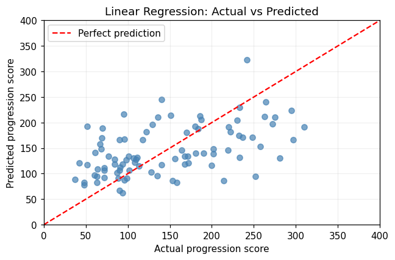
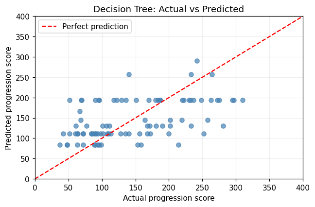
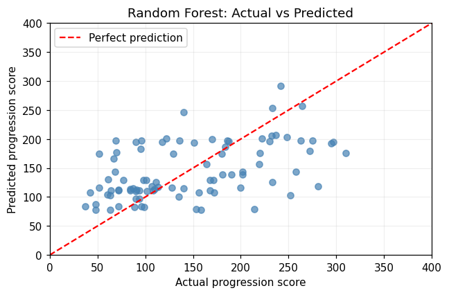
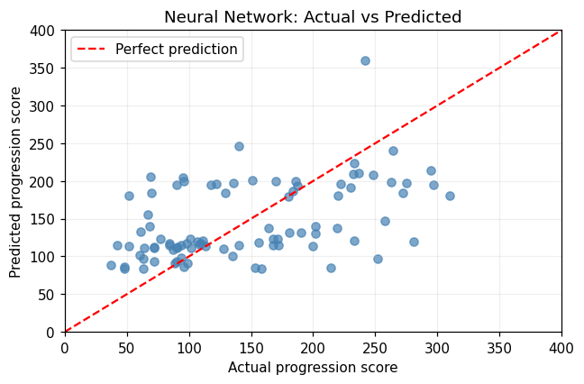
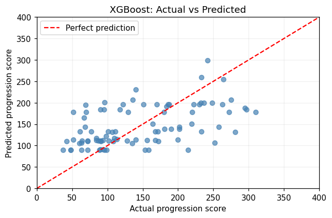
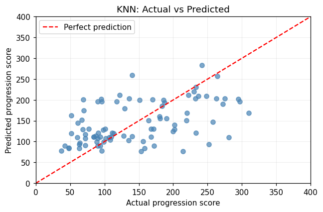
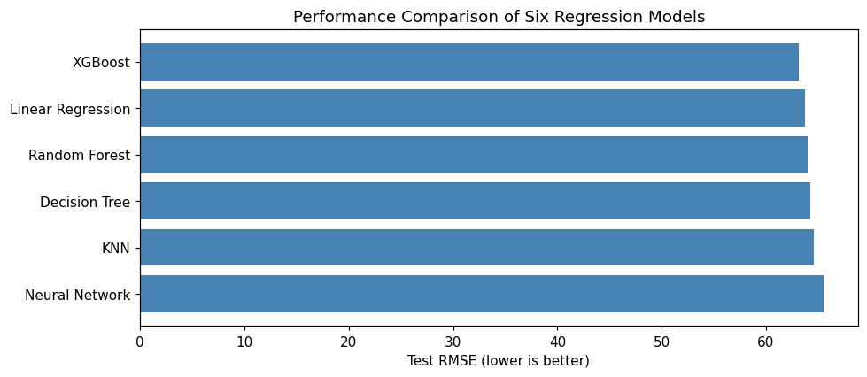

# Comparative Implementation of Machine Learning Regression Algorithms

## Student Information

| Field | Details |
|---|---|
| Student name | Muhammad Yahya Tamimy |
| Registration number | FA23-BAI-020 |
| Task | Comparative implementation of six regression algorithms |
| Dataset | Diabetes regression dataset |
| Source notebook | `RegressionTask_FA23_BAI_020_YahyaTamimy.ipynb` |

## Abstract

This study compares six regression algorithms for predicting disease progression from Body Mass Index (BMI): Linear Regression, Decision Tree Regression, Random Forest Regression, Neural Network Regression, XGBoost Regression and K-Nearest Neighbors (KNN) Regression. The Diabetes dataset contains 442 observations. All models use the same predictor, target and 80:20 training/testing split, producing 353 training observations and 89 test observations. Preprocessing is fitted using training data only. Performance is evaluated using MAE, MSE, RMSE and R². XGBoost achieves the lowest test RMSE of 63.1144 and the highest R² of 0.2481. KNN achieves the lowest MAE of 50.7154. XGBoost is selected as the best-performing model under the primary criterion of minimum RMSE, although its advantage over Linear Regression is small.

## 1. Introduction

Regression is a supervised machine learning approach used to predict numerical values. Different regression algorithms represent relationships in different ways: Linear Regression fits a straight line, trees divide observations into groups, ensembles combine trees, neural networks learn weighted transformations, and KNN averages nearby observations.

The purpose of this assignment is to apply these approaches to the same prediction problem and compare their performance under a consistent evaluation procedure. The implementation gives each model separate cells for training, prediction, metric calculation and visualization. A final table compares the six sets of test results.

## 2. Objectives

The objectives are to:

1. Select and inspect a suitable regression dataset.
2. Prepare the data and create one shared 80:20 split.
3. Implement six regression models using Python libraries.
4. Apply scaling where appropriate without fitting preprocessing on test data.
5. Evaluate every model using MAE, MSE, RMSE and R².
6. Visualize actual versus predicted values and compare the models.
7. Identify the best model using a stated performance criterion.

## 3. Dataset Description

The implementation uses the Diabetes regression dataset available through `sklearn.datasets.load_diabetes`. The dataset has 442 observations and 10 available input variables. This experiment deliberately selects only BMI so that all models solve the same simple problem and the corresponding manual calculations remain manageable.

| Item | Description |
|---|---|
| Number of observations | 442 |
| Available predictors | 10 |
| Selected predictor | BMI (`bmi`) |
| Target | Disease progression score (`progression`) |
| Target description | A quantitative measure of disease progression one year after baseline |
| Missing BMI values | 0 |
| Missing target values | 0 |

The target is a numerical score, rather than a diagnosis, percentage or blood glucose measurement. The dataset is loaded with `scaled=False` to retain the original input units. Any required standardization is then learned from the training partition.

### 3.1 Sample Observations

The first five records printed by the notebook are:

| Record | BMI | Progression score |
|---|---:|---:|
| 1 | 32.1 | 151 |
| 2 | 21.6 | 75 |
| 3 | 30.5 | 141 |
| 4 | 25.3 | 206 |
| 5 | 23.0 | 135 |

### 3.2 Descriptive Statistics

| Statistic | BMI | Progression score |
|---|---:|---:|
| Count | 442 | 442 |
| Mean | 26.38 | 152.13 |
| Standard deviation | 4.42 | 77.09 |
| Minimum | 18.00 | 25.00 |
| Median | 25.70 | 140.50 |
| Maximum | 42.20 | 346.00 |

## 4. Tools and Libraries

| Library or component | Purpose |
|---|---|
| NumPy | Numerical calculations and square-root computation |
| pandas | Data inspection, comparison tables and CSV export |
| Matplotlib | Scatter plots and the RMSE comparison chart |
| scikit-learn | Dataset loading, preprocessing, splitting, five models and evaluation metrics |
| XGBoost | Gradient-boosted tree regression |
| Jupyter notebook | Separate, sequential implementation of each model |

The saved notebook outputs identify **scikit-learn 1.8.0** and **XGBoost 3.4.1**. Results in this report are taken from those saved outputs.

## 5. Methodology

### 5.1 Input and Target Selection

The predictor and target are selected as follows:

```python
X = df[['bmi']]
y = df['progression']
```

No additional predictors are introduced for any individual model.

### 5.2 Shared Training and Testing Split

The split is created once and reused throughout the experiment:

```python
X_train, X_test, y_train, y_test = train_test_split(
    X, y, test_size=0.20, random_state=42
)
```

| Partition | Number of observations |
|---|---:|
| Training | 353 |
| Testing | 89 |
| Total | 442 |

Whole-number sample counts cause the proportions to differ slightly from exactly 80% and 20%. The fixed random state makes the split reproducible.

### 5.3 Missing Values and Feature Scaling

The notebook confirms that both selected columns have no missing values. A median `SimpleImputer` is nevertheless fitted to the training inputs as a precaution, then applied to the test inputs.

`StandardScaler` is fitted to the cleaned training inputs and applied to both partitions. KNN and the neural network use these scaled inputs. Linear Regression and the three tree-based models use the cleaned inputs in original units.

Standardization uses:

$$
z = \frac{x-\mu_{\text{train}}}{\sigma_{\text{train}}}
$$

With one input feature, standardization does not change the ordering of KNN distances because all distances are divided by the same positive standard deviation. It is still included as a consistent preprocessing practice.

The neural network's training targets are also standardized. Its predictions are inverse-transformed to original progression-score units before any metrics are calculated. Test targets are not used to fit either scaler.

### 5.4 Evaluation Procedure

Each model follows the same sequence:

1. Fit the estimator using the training partition.
2. Predict the targets for the shared test partition.
3. Calculate all four evaluation metrics.
4. Plot actual versus predicted test values.
5. Include the model's metrics in the final comparison table.

Model settings are fixed in the notebook. No hyperparameter search or cross-validation is performed. Therefore, the comparison concerns the implemented configurations, rather than the best possible configuration of each algorithm.

## 6. Regression Models

### 6.1 Linear Regression

Linear Regression fits a straight-line relationship between BMI and progression:

$$
\hat y = a + bx
$$

The coefficients minimize the sum of squared training errors. The implementation uses `LinearRegression()` with cleaned, unscaled BMI values. This model provides an interpretable baseline against which more flexible approaches can be compared.

### 6.2 Decision Tree Regression

A Decision Tree splits observations using BMI thresholds and predicts the mean target within each leaf. The implementation uses:

```python
DecisionTreeRegressor(
    max_depth=3, min_samples_leaf=5, random_state=42
)
```

Restricting depth and requiring at least five training observations per leaf limits tree complexity. Predictions remain constant within individual leaves.

### 6.3 Random Forest Regression

Random Forest fits multiple regression trees on bootstrap samples and averages their predictions:

$$
\hat y_{\text{RF}}(x) = \frac{1}{T}\sum_{t=1}^{T}\hat y_t(x)
$$

The implementation uses 200 trees, maximum depth 4, a minimum of 5 observations per leaf, `random_state=42` and `n_jobs=1`. With only one predictor, diversity comes from bootstrap samples; there are no alternative input features to select at splits.

### 6.4 Neural Network Regression

The neural network uses `MLPRegressor` with two hidden layers containing 16 and 8 neurons. ReLU activation introduces nonlinearity, while the output is a numerical prediction.

The configuration uses the L-BFGS solver, `alpha=0.1`, `max_iter=5000`, `max_fun=100000` and `random_state=42`. Both BMI and the training targets are standardized. Predicted targets are returned to their original scale before evaluation.

### 6.5 XGBoost Regression

XGBoost builds trees sequentially, adding corrections to the current prediction:

$$
F_m(x) = F_{m-1}(x) + \eta f_m(x)
$$

Here, $\eta$ is the learning rate and $f_m$ is the new tree's correction. The implementation uses the `reg:squarederror` objective, 200 trees, maximum depth 2, learning rate 0.03 and `reg_lambda=1.0`. Both `subsample` and `colsample_bytree` are 1.0, with `random_state=42` and `n_jobs=1`.

### 6.6 KNN Regression

KNN predicts the average target of the nearest training observations:

$$
\hat y(x) = \frac{1}{k}\sum_{i\in N_k(x)}y_i
$$

The implementation uses `KNeighborsRegressor(n_neighbors=15, weights='uniform')` with standardized BMI. The prediction is therefore the unweighted mean of the targets of the 15 selected neighbors.

## 7. Evaluation Metrics

Let $n$ be the number of test observations, $y_i$ the actual target, $\hat y_i$ the prediction, and $\bar y$ the mean of the test targets.

### 7.1 Mean Absolute Error

$$
MAE = \frac{1}{n}\sum_{i=1}^{n}|y_i-\hat y_i|
$$

MAE measures average absolute prediction error in progression-score units. Lower values are better.

### 7.2 Mean Squared Error

$$
MSE = \frac{1}{n}\sum_{i=1}^{n}(y_i-\hat y_i)^2
$$

MSE penalizes large errors more strongly than MAE. Its units are squared progression-score units. Lower values are better.

### 7.3 Root Mean Squared Error

$$
RMSE = \sqrt{MSE}
$$

RMSE expresses squared-error performance in the original target units. It is the primary ranking criterion in this experiment.

### 7.4 R Squared Score

$$
R^2 = 1-\frac{\sum_{i=1}^{n}(y_i-\hat y_i)^2}
{\sum_{i=1}^{n}(y_i-\bar y)^2}
$$

R² compares squared prediction error with always predicting the test-target mean. Higher values are better. A value of 1 indicates perfect prediction; 0 matches this mean benchmark; a negative value is worse than the benchmark. R² is not classification accuracy.

## 8. Experimental Results

The following table reproduces the notebook's final comparison output, ordered by increasing test RMSE. Values are rounded to four decimal places.

| Rank by RMSE | Algorithm | MAE | MSE | RMSE | R² |
|---:|---|---:|---:|---:|---:|
| 1 | XGBoost Regression | 51.2092 | **3983.4308** | **63.1144** | **0.2481** |
| 2 | Linear Regression | 52.2600 | 4061.8259 | 63.7325 | 0.2334 |
| 3 | Random Forest Regression | 51.1834 | 4097.0918 | 64.0085 | 0.2267 |
| 4 | Decision Tree Regression | 52.1313 | 4130.6680 | 64.2703 | 0.2204 |
| 5 | KNN Regression | **50.7154** | 4166.4215 | 64.5478 | 0.2136 |
| 6 | Neural Network Regression | 52.5289 | 4294.9432 | 65.5358 | 0.1894 |

### 8.1 Best Model by RMSE

XGBoost achieves the lowest RMSE of **63.1144**, the lowest MSE of **3983.4308**, and the highest R² of **0.2481**. These rankings agree because MSE, RMSE and R² are mathematically related when calculated on the same test observations.

Linear Regression is the closest competitor, with RMSE **63.7325**. XGBoost reduces RMSE by approximately **0.6181 points**, or **0.97%**, relative to the linear baseline. This is a modest improvement, rather than a large performance gap.

### 8.2 Best Model by MAE

KNN achieves the lowest MAE of **50.7154**. It therefore has the smallest average absolute error in this run. Its RMSE is higher than XGBoost's because squared-error measures give greater weight to larger errors. The preferred model depends on the error criterion: this study selects XGBoost using minimum RMSE.

### 8.3 Performance of the Other Models

Random Forest and Decision Tree produce RMSE values of **64.0085** and **64.2703**, respectively. They capture nonlinear thresholds but do not outperform the linear baseline on this split. The neural network has the highest RMSE of **65.5358** in the implemented configuration. These results demonstrate that additional model complexity does not automatically improve held-out performance.

## 9. Actual Versus Predicted Visualizations

The figures below are extracted directly from the uploaded notebook's saved outputs. Each scatter plot places actual progression scores on the horizontal axis and predicted scores on the vertical axis. The dashed red diagonal represents perfect predictions. All six plots use identical limits from 0 to 400, supporting consistent visual comparison.

### 9.1 Linear Regression



**Figure 1.** Linear Regression test predictions. The points show substantial scatter around the perfect-prediction line, despite the model's competitive RMSE.

### 9.2 Decision Tree Regression



**Figure 2.** Decision Tree test predictions. Repeated prediction levels arise because all observations assigned to a particular leaf receive the same predicted target.

### 9.3 Random Forest Regression



**Figure 3.** Random Forest test predictions. Averaging multiple trees produces more prediction levels than a single tree, but substantial errors remain.

### 9.4 Neural Network Regression



**Figure 4.** Neural Network test predictions after inverse-transforming the output to progression-score units. This configuration produces the largest RMSE among the six models.

### 9.5 XGBoost Regression



**Figure 5.** XGBoost test predictions. Its aggregate squared error is lowest in the experiment, although individual prediction errors remain visible.

### 9.6 KNN Regression



**Figure 6.** KNN test predictions using 15 neighbors. Local averaging gives the lowest MAE, while its RMSE remains higher than that of XGBoost.

### 9.7 RMSE Comparison



**Figure 7.** Models ranked by test RMSE. Shorter bars indicate lower error. The relatively narrow differences between models support a cautious interpretation of the ranking.

Overall, the plots show that predictions tend to occupy a narrower range than actual targets, with considerable deviations from the diagonal. Together with R² values below 0.25, this indicates limited predictive performance for the BMI-only experiment.

## 10. Strengths and Limitations of the Algorithms

| Algorithm | Strengths | Limitations |
|---|---|---|
| Linear Regression | Fast, simple and interpretable; competitive baseline in this study | A straight line cannot represent complex nonlinear relationships; sensitive to unusual observations |
| Decision Tree | Captures threshold effects; does not require feature standardization | Splits can be unstable; deeper trees may overfit; leaf predictions are constant |
| Random Forest | Averaging reduces the variance of individual trees | Less interpretable; higher computational cost; one predictor limits feature-based diversity |
| Neural Network | Can learn flexible nonlinear relationships | Requires appropriate scaling and optimization; performance depends on architecture and regularization |
| XGBoost | Sequential corrections and regularization provide flexible prediction | Several interacting hyperparameters; excessive complexity can fit noise |
| KNN | Simple local averaging with few modeling assumptions | Sensitive to the choice of k; stores training observations; poor extrapolation |

## 11. Study Limitations and Possible Improvements

The conclusions are limited to the implemented experiment:

1. **One predictor:** BMI is the only input. Other available variables may provide useful information about progression.
2. **One test split:** Performance can change when different observations enter the training or test partition.
3. **Fixed hyperparameters:** The settings are not selected through a training-only search. Models have not necessarily reached their best achievable performance.
4. **Small observed differences:** No repeated-split analysis or uncertainty estimate is included, so the ranking does not establish statistical superiority.
5. **Limited scope:** The models are educational implementations and have not been clinically validated.

A useful follow-up would compare the full set of available predictors and tune model settings with cross-validation inside the training partition. The final test partition should remain untouched until the selected configurations are evaluated.

## 12. Conclusion

All six regression algorithms were implemented separately using the same BMI predictor, disease progression target and shared 80:20 split. Training-only preprocessing preserved the separation between fitting and test evaluation. Each model was assessed using four metrics and an actual-versus-predicted graph.

**XGBoost is the best-performing model under the primary RMSE criterion**, achieving RMSE **63.1144**, MSE **3983.4308** and R² **0.2481**. **KNN achieves the best MAE of 50.7154**. Linear Regression remains competitive, with a small RMSE difference from XGBoost and a simpler interpretation.

The results show that the choice of metric matters and that greater model complexity does not guarantee better performance. The modest R² values also show that the BMI-only setup leaves substantial variation unexplained. The selected winner should therefore be understood as the best configuration in this experiment, rather than a universally superior regression algorithm.

## 13. Reproducing the Work

1. Open `RegressionTask_FA23_BAI_020_YahyaTamimy.ipynb` in Jupyter or Google Colab.
2. Install NumPy, pandas, Matplotlib, scikit-learn and XGBoost if needed.
3. Run the notebook from top to bottom so all models reuse the original split and preprocessing objects.
4. Review the individual model outputs and the final comparison table.
5. The last code cell exports `regression_comparison.csv` and `regression_predictions.csv`.

The report's figures are copies of the saved notebook outputs, not plots from a new experiment. Small numerical differences may occur when rerunning under different library versions.

## References

1. Muhammad Yahya Tamimy. *RegressionTask_FA23_BAI_020_YahyaTamimy.ipynb*. Submitted notebook; primary source for implementation details, saved results and figures in this report.
2. scikit-learn. [Diabetes dataset documentation](https://scikit-learn.org/stable/modules/generated/sklearn.datasets.load_diabetes.html).
3. scikit-learn. [Supervised learning documentation](https://scikit-learn.org/stable/supervised_learning.html).
4. scikit-learn. [Model evaluation documentation](https://scikit-learn.org/stable/modules/model_evaluation.html).
5. XGBoost. [Parameter documentation](https://xgboost.readthedocs.io/en/stable/parameter.html).
